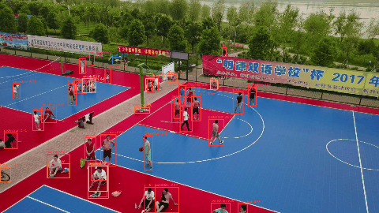
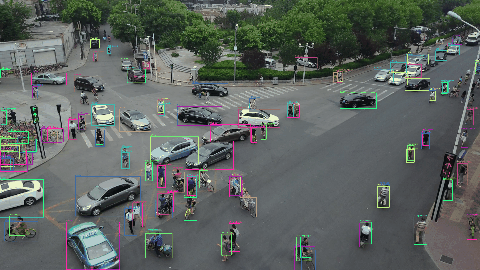

# Drone Tracking

Detect and track vehicles and pedestrians in drone footage: every object gets an identity that it
keeps from frame to frame. Built on the [VisDrone](https://github.com/VisDrone/VisDrone-Dataset)
dataset, where 60% of the objects are smaller than 32×32 pixels.

| Off-the-shelf YOLO26n (COCO) | Fine-tuned on VisDrone | Fine-tuned + tiling |
|---|---|---|
|  |  |  |
| 15 detections per frame | 30 detections per frame | 48 detections per frame |

## Results so far

**Experiment 1: fine-tuning on drone imagery.** VisDrone-DET val (548 images, 38,759 objects),
6 classes shared with COCO (pedestrian and people merged into "person" so both models are judged fairly).

| | Off-the-shelf (COCO) | Fine-tuned | Gain |
|---|---|---|---|
| mAP@50 | 0.144 | **0.343** | ×2.4 |
| mAP@50-95 | 0.083 | **0.192** | ×2.3 |

Largest gains on objects COCO rarely sees from above: motorcycles 0.05 → 0.34, trucks 0.08 → 0.25.
Fine-tuning: 50 epochs in 43 minutes on one L4 GPU ([Modal](https://modal.com)).
Full tables and analysis: [docs/RESULTATS.md](docs/RESULTATS.md) (French).

**Experiment 2: tiling for small objects.** Same model, run on 640×640 full-resolution tiles
(20% overlap) plus the downscaled whole image, duplicates removed with class-wise NMS.

| | Whole image | Tiles + whole image | |
|---|---|---|---|
| mAP@50, small objects (< 32×32 px) | 0.169 | **0.281** | +66% |
| mAP@50, all objects | 0.273 | **0.374** | +37% |
| Speed (MacBook Air M1) | ~60 img/s | ~6.4 img/s | ~10× slower |

A finding worth noting: **SAHI's default box merging made things worse than no tiling at all**
(mAP@50 0.248). An ablation isolates the cause: merging, not the IoS overlap metric. In VisDrone's
dense parking lots and crowds it fuses neighbouring objects into one box. Plain NMS is the default here.

**Experiment 3: our tracker vs ByteTrack.** Homemade ByteTrack-style tracker (Kalman filter, Hungarian
matching, two-pass association) against Ultralytics' ByteTrack, **fed the exact same cached detections**,
same settings. VisDrone-MOT val: 7 videos, 2,846 frames, 5 classes.



| | MOTA | IDF1 | ID switches | Tracker speed (M1) |
|---|---|---|---|---|
| Ultralytics ByteTrack | 0.177 | 0.403 | 1,180 | ~270 fps |
| **Ours** | **0.193** | **0.416** | **909** (−23%) | ~350 fps |

The first version lost (MOTA 0.070): the whole gap came from one Ultralytics setting, `fuse_score`
(overlap weighted by detection confidence); without it Ultralytics scores 0.044. Our MOTA / IDF1 code is
checked against [TrackEval](https://github.com/JonathonLuiten/TrackEval): identical IDF1, MOTA within 0.0005.
Most remaining errors come from the detector (e.g. vans labelled as cars), not from the tracker.
Tiling, which helps detection mAP, *hurts* tracking (MOTA −0.18): at a fixed threshold it mostly adds false alarms.

**The mAP is computed by our own code** (COCO method, [det_metrics.py](src/dronetrack/eval/det_metrics.py)),
unit-tested on hand-checkable cases and cross-checked against Ultralytics: on the same predictions the two
agree within 0.002.

## Roadmap

- [x] Step 0: pretrained YOLO on VisDrone videos (baseline)
- [x] Step 1: VisDrone → YOLO conversion, dataset statistics
- [x] Step 2: fine-tuning on a cloud GPU, homemade mAP, **experiment 1**
- [x] Step 3: homemade tiling for small objects: accuracy vs speed (**experiment 2**)
- [x] Step 4: homemade multi-object tracker (Kalman filter + Hungarian matching, ByteTrack-style),
      MOTA / IDF1, compared with Ultralytics' ByteTrack (**experiment 3**)
- [ ] Step 5: online demo
- [ ] Next: counter-drone variant (detect and track drones in the sky), ONNX / C++ speed benchmark

## Design

Each stage does one thing and they all exchange the same two objects: `Detection` (a box, a score,
a class) and `Track` (a detection plus a persistent identity). The tracker never knows which detector
produced its boxes, so the detector or the dataset can be swapped without touching the rest.

```
video → frames → detect → list[Detection] → track → list[Track] → draw (annotated video)
                                                              └→ evaluate (mAP, MOTA, IDF1)
```

| Part | Choice | Why |
|---|---|---|
| Detector | Ultralytics YOLO26n, fine-tuned | Rewriting YOLO adds nothing |
| Small-object tiling | Homemade (SAHI-like), with NMS or SAHI-style merging | To understand and measure the trade-off |
| Tracker | Homemade, ByteTrack-style (Kalman + Hungarian, two passes) | Core algorithmic part |
| Metrics | Homemade mAP, MOTA, IDF1 | Each checked against the official tool |

Every technical choice and its reason: [docs/DECISIONS.md](docs/DECISIONS.md).
Glossary of the terms used: [docs/GLOSSAIRE.md](docs/GLOSSAIRE.md) (French).

## Run it

Requires [uv](https://docs.astral.sh/uv/).

```bash
uv sync
uv run pytest                                              # unit tests
uv run scripts/download_visdrone.py det-val                # 82 MB
uv run scripts/evaluate_detector.py --weights yolo26n.pt --coco --classes 0 2 3 5 8 9 --merge-person
uv run scripts/run_detect.py --source path/to/video.mp4 --weights yolo26n.pt --coco --gif out.gif
uv run scripts/run_detect.py --source path/to/video.mp4 --weights models/visdrone_y26n.pt --tiles --gif out.gif
uv run scripts/run_track.py --source path/to/frames_or_video --weights models/visdrone_y26n.pt --gif track.gif
uv run scripts/evaluate_tracker.py --weights models/visdrone_y26n.pt --check-reference
```

Fine-tuning on Modal: `modal run --detach scripts/modal_train.py` (see the script's header).

## Credits and licenses

- Data: VisDrone (AISKYEYE team, Tianjin University), for non-commercial academic use.
- Detector: [Ultralytics YOLO](https://github.com/ultralytics/ultralytics) (AGPL-3.0), which requires code built on it to stay open source.
